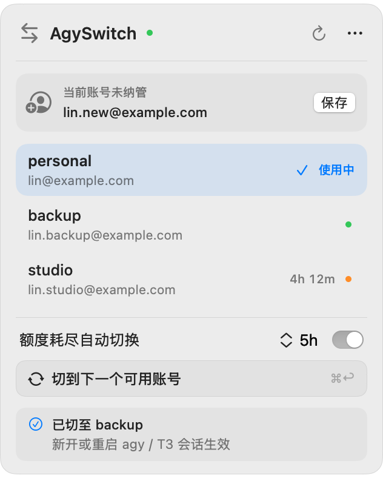
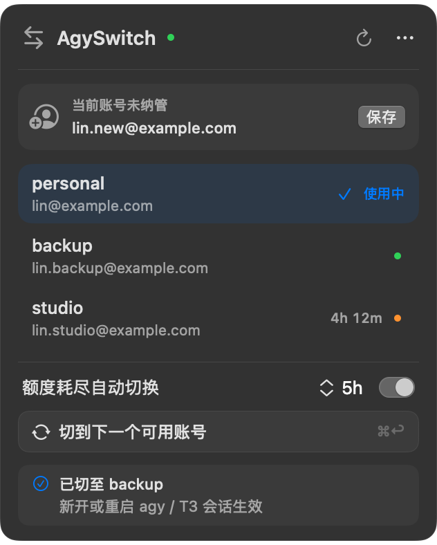
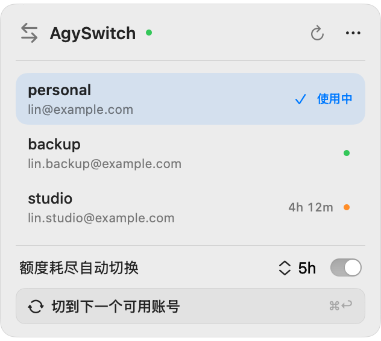
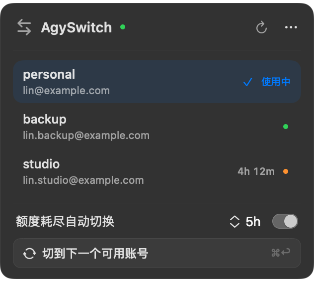

# AgySwitch

> **AgySwitch** is a lightweight (**2.3 MB**), native macOS menu bar app built with pure Swift & SwiftUI for switching multiple **Google Antigravity CLI (`agy`)** accounts via macOS Keychain—with **zero network requests**, **no proxy/gateway**, and **automatic quota-exhaustion switching** via passive local log monitoring.

**AgySwitch** 是一款专为 **Google Antigravity CLI（`agy`）** 打造的 **macOS 原生菜单栏多账号切换工具**。

100% 纯原生 Swift + SwiftUI + AppKit 构建，零第三方依赖，整个 App 仅 **2.3 MB**。全程**零网络请求**、不做代理网关、不改任何配置与对话历史，只做一件事：在顶部菜单栏安全、顺手地保存与切换本机登录凭证，并在额度用光时自动切到下一个可用账号。

---

## 下载安装 · Download（macOS 14+ · Apple Silicon）

- 📦 [**下载 DMG 安装包（1.5 MB）**](https://github.com/wanghao-SunSky/AgySwitch/releases/download/v0.1.0/AgySwitch-v0.1.0-macos-arm64.dmg)
- 🗂️ [**下载 ZIP 压缩包（1.2 MB）**](https://github.com/wanghao-SunSky/AgySwitch/releases/download/v0.1.0/AgySwitch-v0.1.0-macos-arm64.zip)
- 🔗 [**Releases 页面（含 SHA-256 校验值）**](https://github.com/wanghao-SunSky/AgySwitch/releases/latest)

### 首次打开说明（Gatekeeper 放行）

因未购买 Apple 付费开发者证书、采用本地 ad-hoc 签名，首次将 `AgySwitch.app` 拖入 `/Applications` 打开时，若 macOS 提示「已损坏」或「无法验证开发者」，在终端运行一行命令即可正常启动：

```bash
xattr -cr /Applications/AgySwitch.app
```

---

## 界面预览 · Screenshots

| 未纳管新账号提示与完整状态（浅色） | 未纳管新账号提示与完整状态（深色） |
| :---: | :---: |
|  |  |
| **日常紧凑面板（浅色）** | **日常紧凑面板（深色）** |
|  |  |

---

## 为什么做 AgySwitch · Comparison

重度使用 Gemini 4 系列模型（如 Gemini 4 Neon）时，单个 Pro 账号额度往往很快见底，需要多个 Google 账号轮换。AgySwitch 与常见方案的核心区别如下：

| 对比维度 | **AgySwitch（本工具）** | 本地反代 / OAuth 网关类工具 | 官方手动 `/logout` 重登 |
| :--- | :--- | :--- | :--- |
| **对话流量链路** | **100% 官方原版 `agy` 直连** | 第三方网关代理转发 | 官方原版 `agy` 直连 |
| **额外网络请求** | **零网络请求**（不轮询私有接口） | 持续调用/转发私有接口 | 无 |
| **切号速度** | 菜单栏点一下或 `⌘↩` 秒切 | 自动路由 | 登出 + 开浏览器重新授权 |
| **额度用光自动切号** | 支持（纯本地被动监听日志） | 支持（网关侧检测） | 不支持 |
| **安装包体积** | **2.3 MB**（纯原生 SwiftUI） | 几十至数百 MB | — |
| **配置侵入度** | 只切 Keychain 单条登录凭证 | 需接管网关/代理配置 | 无 |

---

## 核心特性 · Features

### 1. 极致轻量，原生菜单栏常驻
- 100% 原生 Swift + SwiftUI + AppKit 实现，零第三方依赖。
- 整个 `AgySwitch.app` 仅 **2.3 MB**（主可执行文件 **1.4 MB**），常驻顶部菜单栏（`LSUIElement`，不占 Dock），自动跟随系统浅色 / 深色模式，支持一键开启登录时启动。

### 2. 即存即切，不打断心流
- **新号自动感知**：点击菜单栏图标弹出面板，若检测到当前 Keychain 中登录了尚未入库的新账号，顶部自动浮现「保存」胶囊，输入别名回车即存。
- **一键切换**：单击任意账号行即可秒切；按快捷键 `⌘↩` 直接切到下一个可用账号。
- **冷却管理**：右键账号行可手动标记冷却、清除冷却、重命名别名或移除账号。

### 3. 额度耗尽自动切换（纯本地日志监听）
- 开启底部「额度耗尽自动切换」开关后，AgySwitch 仅在本地被动追踪 `~/.gemini/antigravity-cli/log/cli-*.log` 的新增内容，**不发任何网络探测请求**。
- 自动识别 `RESOURCE_EXHAUSTED`、`QUOTA_EXHAUSTED`、`MODEL_CAPACITY_EXHAUSTED` 及 `429` 限流错误：
  - 内置 glog 线程号 `429` 与配置项误报过滤；
  - 内置 30 秒防抖窗口与旧日志自动退役机制（切号后立即退役旧会话日志，避免运行中的旧进程继续报错触发连切）；
  - 优先从日志解析官方配额重置时间；若无重置时刻，则按面板设定的 `5h / 3h / 1h` 默认冷却时长标记当前账号；
  - 自动切到下一个可用账号并弹出 macOS 系统通知提醒。

### 4. 凭证安全与底层机制
AgySwitch 只操作 macOS Keychain 中与登录态直接相关的单一条目，绝不修改 `agy` 的 `settings.json`、对话历史、MCP 配置或 Skills：

1. **原样无损读写**：仅读写 login Keychain 中的 `gemini / antigravity` 条目，原样保留 `go-keyring-base64:` 前缀及原始字节。
2. **密文快照与元数据分离**：
   - 每个账号的凭证快照独立存入 login Keychain 的 `agy-acct-vault` 命名空间；
   - 本地元数据文件 `~/.config/agy-acct/registry.json`（目录 `0700`、文件 `0600`、读写全程 `flock` 排他锁）仅保存别名、邮箱与冷却时间戳，**不落盘任何明文 Token**。
3. **stdin 管道传参防泄露**：通过 `/usr/bin/security -i` 的标准输入传递敏感命令，避免凭证出现在进程命令行参数（`ps`）中。
4. **静默刷新自动回写**：切换账号前，先把当前活跃账号可能已在后台被 `agy` 刷新过的新凭证回写进快照库，避免切回时登录态过期。
5. **逐字节回读校验**：写入目标账号凭证后立即回读并逐字节比对，校验通过才更新活跃状态。

---

## 常见问题 · FAQ

**Q：切号后为什么正在跑的对话还是旧账号？**  
因为 `agy`（以及接入它的 T3 等客户端）在会话启动时才会将 Keychain 凭证读入内存。在 AgySwitch 中切换账号（含自动切号）后，**新开或重启一下当前会话**即可生效。

**Q：支持 Intel Mac 或 Windows / Linux 吗？**  
目前仅提供 Apple Silicon（`arm64`）原生构建包，要求 macOS 14.0 及以上系统。

**Q：如何保存多个账号？**  
先用 `agy` 登录第一个账号，点击顶部菜单栏 `⇄` 图标点「保存」；随后在 `agy` 中执行 `/logout` 登录第二个账号，再点菜单栏「保存」即可。

**Q：会触发 Google 封号风控吗？**  
AgySwitch 不做代理网关、不篡改请求协议、不发任何额外网络请求，所有流量 100% 仍由官方原版 `agy` 直连 Google，架构上彻底避开了第三方 OAuth 反代特征。但多账号轮换本身仍建议遵守平台条款，按日常开发节奏正常切换，避免用主力账号高频异常刷额度。

---

## 从源码构建 · Build from Source

环境要求：macOS 14.0+（Apple Silicon `arm64`），Xcode / Swift 5.9+。

```bash
# 编译打包并安装到 /Applications/AgySwitch.app
./scripts/build_app.sh --install

# 运行单元测试
swift test
```

---

## License

[MIT License](LICENSE)
