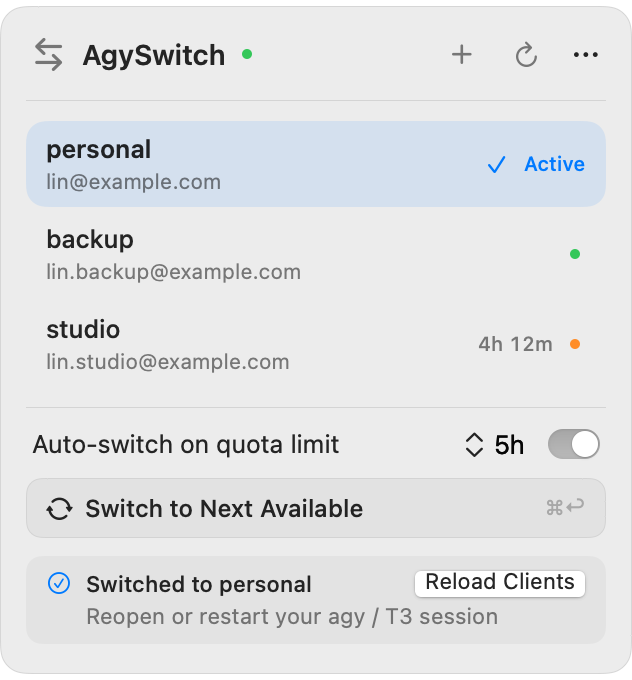
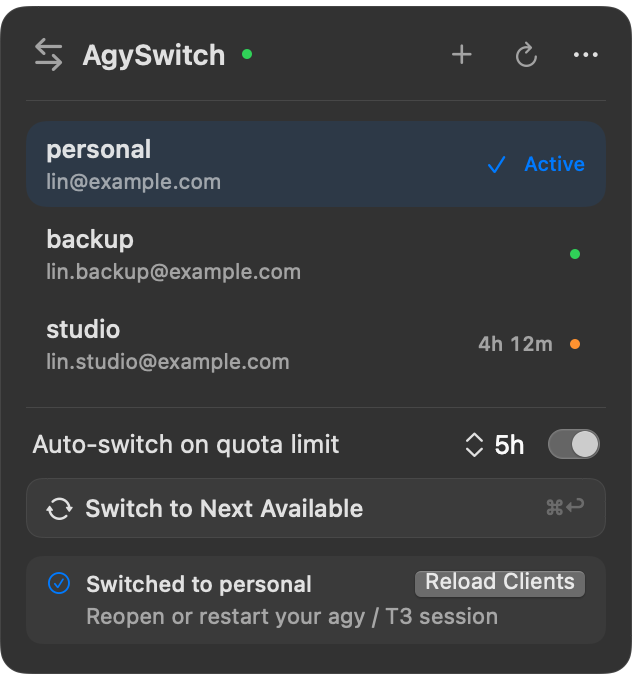
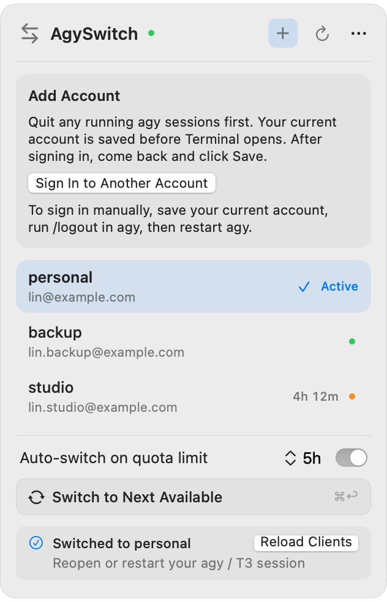
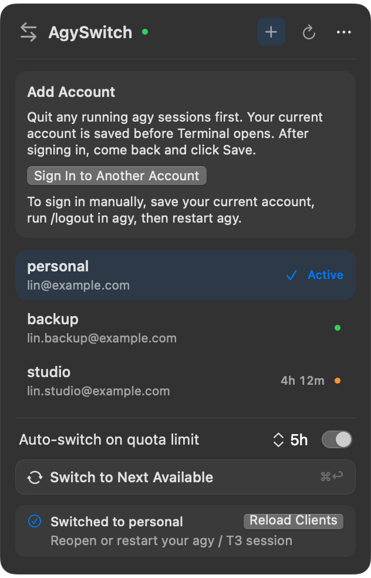

# AgySwitch

English | [简体中文](README.zh-CN.md)

> **AgySwitch** is an ultra-lightweight (**~2.5 MB**), native macOS menu bar app built with pure Swift & SwiftUI for switching multiple **Google Antigravity CLI (`agy`)** accounts via lossless macOS Keychain snapshots—featuring **zero third-party dependencies**, **zero network requests**, **no proxy or OAuth gateway**, **automatic quota-exhaustion switching** via passive local log monitoring, and a **built-in English & Simplified Chinese UI** (system-following or instant in-menu switch).

**AgySwitch** sits quietly in your macOS menu bar (`⇄`) and does one job well: capture and switch your local Google Antigravity CLI (`agy`) Keychain credentials in a single click or shortcut—or automatically rotate to the next available account the moment a session hits a quota limit—without intercepting traffic, polling private APIs, or touching your `agy` settings, MCP servers, skills, or conversation history.

---

## Download & Install (macOS 14+ · Apple Silicon `arm64`)

### Option 1: One-Line Terminal Install (Recommended · Verified & No Gatekeeper Prompt)

Downloads the latest release directly from GitHub Releases, verifies its **SHA-256** checksum against `SHA256SUMS.txt`, verifies the bundle identifier and code signature, installs to `/Applications/AgySwitch.app` without browser quarantine attributes, and launches it in your menu bar:

```bash
curl -fsSL https://raw.githubusercontent.com/wanghao-SunSky/AgySwitch/main/scripts/install.sh | bash
```

> Inspect the installer source at [`scripts/install.sh`](scripts/install.sh). To install into your user Applications folder instead, prefix with `AGYSWITCH_INSTALL_DIR="$HOME/Applications"`.

### Option 2: Let Your AI Audit & Build Locally (Zero-Trust · No Gatekeeper Prompt)

Since AgySwitch reads and writes macOS Keychain credentials and uses local ad-hoc signing, you don't have to take prebuilt binaries on faith. Copy and paste this prompt into **Claude Code, Codex, Antigravity (`agy`), or Cursor** to have your own AI agent audit every source file first, report back to you, and build `AgySwitch.app` locally from source once you approve (locally compiled builds carry no browser quarantine attributes and trigger zero Gatekeeper prompts):

```text
Clone https://github.com/wanghao-SunSky/AgySwitch.git to /tmp/AgySwitch and perform a full security audit of every file under Sources/ and scripts/ before building anything:
1. Verify zero network activity: confirm all code under Sources/, scripts/build_app.sh, and scripts/generate_icon.swift makes no network requests (no URLSession, NWConnection, sockets, or outbound calls; only scripts/install.sh downloads releases from this GitHub repo) and Package.swift has zero third-party dependencies.
2. Verify Keychain & file boundaries: confirm it only reads/writes the macOS login Keychain entries for "gemini" / "antigravity" and "agy-acct-vault" via `/usr/bin/security -i` stdin pipes, never writes plaintext tokens to disk (only non-sensitive metadata in ~/.config/agy-acct/registry.json), and never modifies agy's settings.json, MCP configs, skills, or history.
3. Verify passive log monitoring: confirm the quota watcher only tails `~/.gemini/antigravity-cli/log/cli-*.log` and `acp-server-*.log` in read-only mode.

Present a concise security audit report with file and line references and wait for my confirmation. Once I approve, run `swift test`, then run `./scripts/build_app.sh --install` to compile and install `/Applications/AgySwitch.app` from source, and launch it with `open -a /Applications/AgySwitch.app`.
```

### Option 3: Manual Download

- 📦 [**Download DMG Installer (`AgySwitch-v0.2.1-macos-arm64.dmg`)**](https://github.com/wanghao-SunSky/AgySwitch/releases/download/v0.2.1/AgySwitch-v0.2.1-macos-arm64.dmg)
- 🗂️ [**Download ZIP Archive (`AgySwitch-v0.2.1-macos-arm64.zip`)**](https://github.com/wanghao-SunSky/AgySwitch/releases/download/v0.2.1/AgySwitch-v0.2.1-macos-arm64.zip)
- 🔗 [**GitHub Releases & `SHA256SUMS.txt`**](https://github.com/wanghao-SunSky/AgySwitch/releases/latest)

**First Launch Note (Manual Browser Downloads Only)**: Because AgySwitch is distributed with local ad-hoc signing rather than a paid Apple Developer ID certificate, macOS Gatekeeper may quarantine archives downloaded via a web browser. If macOS says the app is "damaged" or "cannot be verified" after dragging it to `/Applications`, clear the browser quarantine attribute once:

```bash
xattr -cr /Applications/AgySwitch.app
```

---

## Screenshots

| Unsaved Account Detection & Full Panel (Light) | Unsaved Account Detection & Full Panel (Dark) |
| :---: | :---: |
|  |  |
| **Compact Daily Menu Bar Panel (Light)** | **Compact Daily Menu Bar Panel (Dark)** |
|  |  |

---

## Why AgySwitch? · Comparison

Heavy daily usage of frontier models in Google Antigravity CLI (`agy`) quickly exhausts a single account's quota window. Here is how **AgySwitch** compares to local proxy gateways and manual `/logout` rotation:

| Dimension | **AgySwitch** | Local Proxy / OAuth Gateway Tools | Manual `/logout` & Re-login |
| :--- | :--- | :--- | :--- |
| **Traffic Path** | **100% stock `agy` direct connection** | Routed through a local proxy / custom gateway | Stock `agy` direct connection |
| **Extra Network Requests** | **Zero network requests** (no private API polling) | Continuous background polling & token proxying | None |
| **Switching Speed** | Instant single click or `⌘↩` in menu bar | Automatic proxy routing | `/logout` + browser OAuth flow every time |
| **Auto-Switch on Quota Exhaustion** | Yes (passive local log tailing) | Yes (gateway error interception) | No |
| **App Footprint** | **~2.5 MB** (100% native Swift & SwiftUI) | Tens to hundreds of MB (Electron / Go / Node runtimes) | — |
| **Config Intrusiveness** | Swaps only 1 Keychain item; touches zero `agy` configs | Overrides API endpoints, proxy env, or client configs | None |
| **Interface Language** | Built-in **English & Simplified Chinese** (live switch) | Varies | — |

---

## Core Features

### 1. Ultra-Lightweight Native macOS Menu Bar App
- Built with **100% pure Swift, SwiftUI, and AppKit** with **zero third-party dependencies**.
- The entire `AgySwitch.app` bundle is only **~2.5 MB** (**~1.6 MB** main executable), runs strictly as a menu bar agent (`LSUIElement`, no Dock icon clutter), adapts automatically to macOS Light and Dark appearances, and supports one-click **Launch at Login**.
- **Built-in Bilingual UI (English & 简体中文)**: Automatically follows your macOS system language by default, or lets you switch between English and Simplified Chinese instantly from the top-right `⋯` menu without restarting.

### 2. Zero-Friction Account Capture, Switching & Client Reload
- **One-Click Add Account (`+`)**: Click `+` in the top bar to safely back up your current login, clear the active login slot, and launch `agy` in a sized macOS Terminal window (`38×108`) for official browser OAuth sign-in. Once signed in, AgySwitch detects the new account automatically and surfaces a top **Save** capsule.
- **One-Click & Shortcut Switching**: Click any account row to switch immediately, or press **`⌘↩`** to jump straight to the next available (non-cooling) account.
- **Optional Client Reload (Desktop + T3 Backend + CLI)**: Click **Reload Clients** on the post-switch banner (or enable **Auto-Reload Clients on Switch** in `⋯`) to gracefully restart a running `Antigravity.app`, recycle `agy acp` backends without closing T3 Code windows, and stop stale `agy` CLI processes so they don't overwrite the newly switched Keychain credential.
- **Cooldown & Account Management**: Right-click any account row to mark a cooldown (`5h` / `3h` / `1h`), clear an active cooldown, rename its alias, or remove the snapshot.

### 3. Automatic Quota-Exhaustion Switching (Passive Local Log Monitoring)
- When **Auto-switch on quota limit** is enabled, AgySwitch passively tails newly appended lines in `~/.gemini/antigravity-cli/log/cli-*.log` and `acp-server-*.log` (covering both terminal `agy` and T3 Code sessions)—**making zero network requests**.
- Accurately detects `RESOURCE_EXHAUSTED`, `QUOTA_EXHAUSTED`, `MODEL_CAPACITY_EXHAUSTED`, and `429` rate-limit errors:
  - **False-Positive Filtering**: Filters out glog thread IDs containing `429` and non-error configuration lines.
  - **30-Second Debounce & Log Retirement**: Retires previous session log markers immediately after a switch so an already-running process emitting trailing errors never triggers cascading switches.
  - **Smart Cooldown Duration**: Parses the official quota reset timestamp from the log whenever available; otherwise falls back to your selected default cooldown (`5h` / `3h` / `1h`).
  - **Native Notification**: Automatically activates the next available account and posts a macOS system notification.

---

## Security & Architecture

AgySwitch touches only the single macOS Keychain item responsible for `agy` authentication and **never modifies** `agy`'s `settings.json`, conversation history, MCP servers, or skills:

1. **Lossless Keychain Snapshot & Restore**: Reads and writes only the `gemini / antigravity` generic password entry in your login Keychain, preserving the exact `go-keyring-base64:` prefix and raw payload byte-for-byte.
2. **Encrypted Credential Vault Isolated from Metadata**:
   - Full credential snapshots are stored inside your macOS login Keychain under the dedicated `agy-acct-vault` service namespace.
   - Local metadata in `~/.config/agy-acct/registry.json` (directory `0700`, file `0600`, guarded by exclusive `flock` file locks) stores only account aliases, masked/display emails, and cooldown timestamps—**never plaintext tokens**.
3. **Stdin Pipe Execution (`security -i`)**: Sensitive Keychain write commands are piped through standard input to `/usr/bin/security -i` so credentials never appear in process command-line arguments (`ps`).
4. **Silent Token-Refresh Write-Back**: Before switching away from the currently active account, AgySwitch automatically syncs the live Keychain payload back to its vault snapshot so silent background OAuth token refreshes performed by `agy` are never lost.
5. **Byte-for-Byte Read-Back Verification**: Every switch immediately reads back the written Keychain entry and verifies it byte-for-byte against the target snapshot before updating the active account state.

---

## Frequently Asked Questions (FAQ)

**Q: Why does a running `agy` session still use the old account right after I switch?**  
`agy` (and host apps that spawn it, such as T3 Code) reads the macOS Keychain credential into memory when a session starts. After switching accounts in AgySwitch (manually or via auto-switch), **start a new session or restart the current `agy` session** for the new account to take effect.

**Q: How do I add multiple Google Antigravity CLI accounts?**  
Log into your first account in `agy`, click the `⇄` icon in the macOS menu bar, type an alias in the top **Save** bar, and press Return. Then run `/logout` inside `agy`, log into your second account, and click **Save** in AgySwitch again.

**Q: Does AgySwitch make any network calls or risk account flags from proxy gateways?**  
No. AgySwitch performs **zero network requests**, runs no local proxy or custom OAuth client, and never alters `agy` traffic. Every API request goes 100% directly from the official `agy` binary to Google. As with any multi-account workflow, follow platform terms and rotate at a normal human development pace.

**Q: Does AgySwitch support Intel Macs, Windows, or Linux?**  
AgySwitch is built specifically for macOS Keychain and currently targets **macOS 14.0+ on Apple Silicon (`arm64`)**.

---

## Build from Source

Requirements: macOS 14.0+ (Apple Silicon `arm64`), Xcode / Swift 5.9+.

```bash
# Build, bundle, ad-hoc sign, and install to /Applications/AgySwitch.app
./scripts/build_app.sh --install

# Run unit tests
swift test
```

---

## License

Released under the [MIT License](LICENSE).
