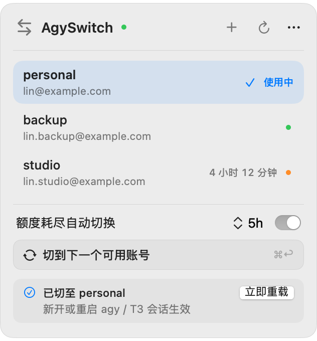
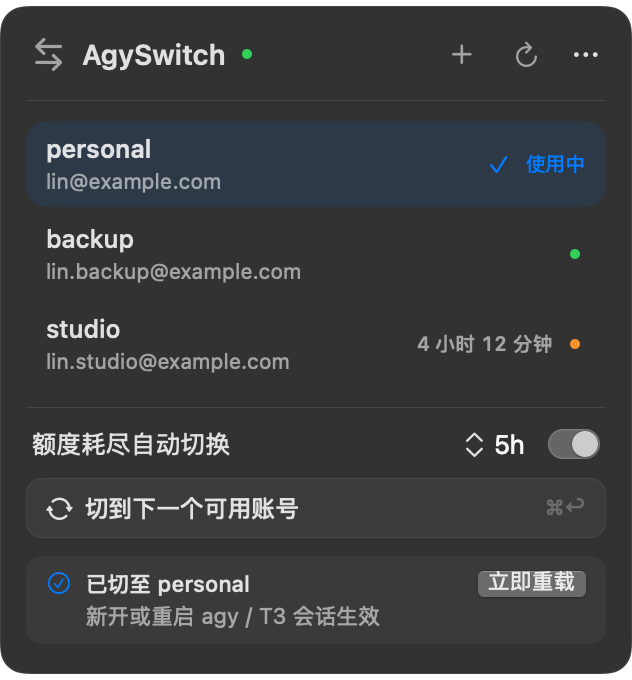
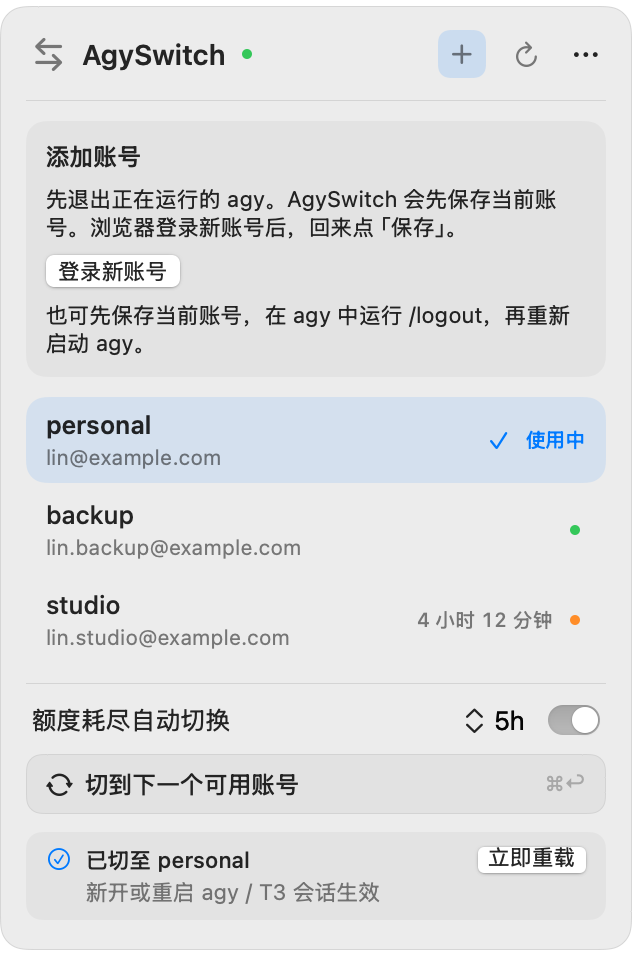
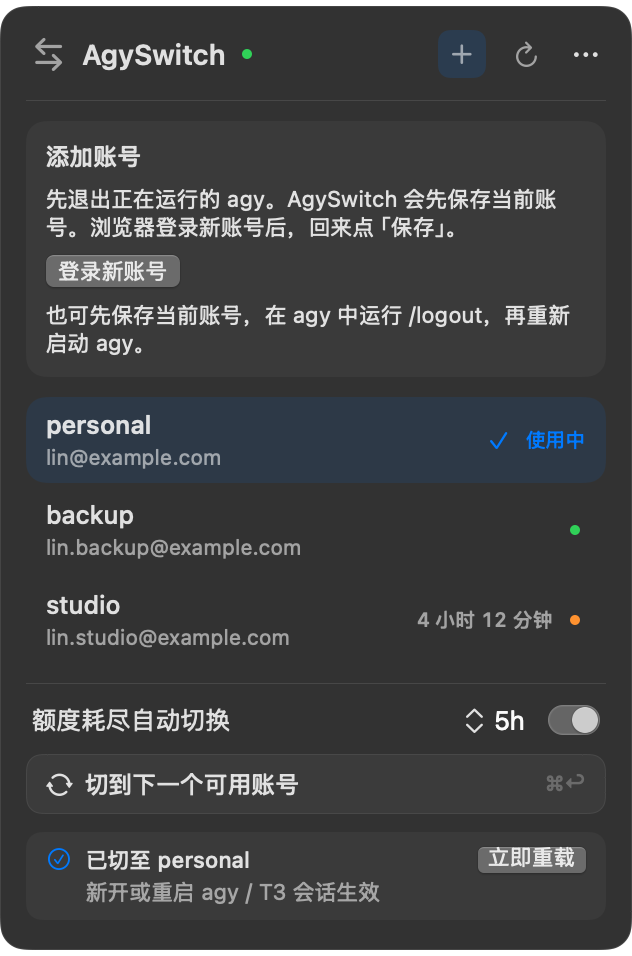

# AgySwitch

[English](README.md) | 简体中文

> **AgySwitch** 是一款专为 **Google Antigravity CLI（`agy`）** 打造的超轻量（**~2.5 MB**）**macOS 原生菜单栏多账号切换工具**——100% 纯 Swift & SwiftUI 构建，**零第三方依赖**、**零网络请求**、**不做本地反代或 OAuth 网关**，基于 macOS Keychain 无损快照秒切账号，支持**纯本地被动日志监听的额度耗尽自动切号**，并内置**简体中文与英文双语界面**（默认跟随系统或菜单内实时切换）。

**AgySwitch** 常驻 macOS 顶部菜单栏（`⇄`），全程不拦截任何网络流量、不轮询私有接口、不修改 `agy` 的任何业务配置、MCP、Skills 或对话历史，只专注做好一件事：安全、顺手地保存与切换本机 `agy` 登录凭证，并在当前账号额度用光时自动切到下一个可用账号。

---

## 下载安装（macOS 14+ · Apple Silicon `arm64`）

### 方式一：终端一键安装（推荐 · 自动校验 SHA-256 · 免 Gatekeeper 弹窗）

通过 `curl` 直接从 GitHub Releases 下载最新安装包，自动比对 `SHA256SUMS.txt` 校验值并核验签名后安装到 `/Applications/AgySwitch.app`，不触发浏览器下载隔离标记，装完自动在顶部菜单栏启动：

```bash
curl -fsSL https://raw.githubusercontent.com/wanghao-SunSky/AgySwitch/main/scripts/install.sh | bash
```

> 可查看完整安装脚本源码：[`scripts/install.sh`](scripts/install.sh)。如需安装到当前用户目录，可在命令前加 `AGYSWITCH_INSTALL_DIR="$HOME/Applications"`。

### 方式二：让你的 AI 先审源码再本机编译安装（零信任 · 免 Gatekeeper 弹窗）

由于 AgySwitch 涉及 macOS Keychain 凭证读写且采用本地 ad-hoc 签名，如果你不想盲信陌生仓库或预编译包、也懒得自己逐行审代码，可以直接复制下方 Prompt 发给 **Claude Code、Codex、Antigravity（`agy`）或 Cursor**，让你的 AI 先逐文件完成安全审计并向你汇报结论，确认无虞后再从本机源码编译安装（本机编译天生无浏览器 quarantine 标记，完全不触发 Gatekeeper 拦截）：

```text
请先把 https://github.com/wanghao-SunSky/AgySwitch.git 克隆到 /tmp/AgySwitch，在执行任何编译或安装前，逐文件审计 Sources/ 和 scripts/ 下的全部代码：
1. 核实零网络请求：确认 Sources/ 全部应用源码以及 scripts/build_app.sh、scripts/generate_icon.swift 没有任何联网或外传数据行为（无 URLSession、NWConnection、Socket 或外部调用；仅 scripts/install.sh 用于从本仓库 Releases 下载安装包），且 Package.swift 零第三方依赖。
2. 核实 Keychain 与文件边界：确认只读写 macOS login Keychain 中的 `gemini / antigravity` 与 `agy-acct-vault` 条目，敏感写入均通过 `/usr/bin/security -i` 标准输入管道传参，不落盘任何明文 Token（`~/.config/agy-acct/registry.json` 仅存别名、邮箱和冷却时间），且绝不修改 `agy` 的 `settings.json`、MCP、Skills 或对话历史。
3. 核实日志监听只读：确认本地额度监听器仅对 `~/.gemini/antigravity-cli/log/cli-*.log` 与 `acp-server-*.log` 做只读监听。

请先向我输出一份简明的安全审计报告（附关键文件与行号）并等待我确认；待我确认安全后，再运行 `swift test` 验证测试通过，随后执行 `./scripts/build_app.sh --install` 从本机源码编译打包安装到 `/Applications/AgySwitch.app`，并用 `open -a /Applications/AgySwitch.app` 启动。
```

### 方式三：手动下载安装包

- 📦 [**下载 DMG 安装包（`AgySwitch-v0.2.1-macos-arm64.dmg`）**](https://github.com/wanghao-SunSky/AgySwitch/releases/download/v0.2.1/AgySwitch-v0.2.1-macos-arm64.dmg)
- 🗂️ [**下载 ZIP 压缩包（`AgySwitch-v0.2.1-macos-arm64.zip`）**](https://github.com/wanghao-SunSky/AgySwitch/releases/download/v0.2.1/AgySwitch-v0.2.1-macos-arm64.zip)
- 🔗 [**Releases 页面（含 `SHA256SUMS.txt` 校验值）**](https://github.com/wanghao-SunSky/AgySwitch/releases/latest)

**手动下载首次打开说明**：因未购买 Apple 付费开发者证书、采用本地 ad-hoc 签名，通过浏览器手动下载后拖入 `/Applications` 打开时，若 macOS 提示「已损坏」或「无法验证开发者」，运行一行命令移除浏览器隔离属性即可：

```bash
xattr -cr /Applications/AgySwitch.app
```

---

## 界面预览 · Screenshots

| 未保存新账号提示与完整状态（浅色） | 未保存新账号提示与完整状态（深色） |
| :---: | :---: |
|  |  |
| **日常紧凑面板（浅色）** | **日常紧凑面板（深色）** |
|  |  |

---

## 为什么做 AgySwitch · 方案对比

重度使用 Google Antigravity CLI（`agy`）的高阶模型时，单个账号的配额窗口往往很快见底，需要多个 Google 账号轮换。**AgySwitch** 与常见方案的核心区别如下：

| 对比维度 | **AgySwitch（本工具）** | 本地反代 / OAuth 网关类工具 | 官方手动 `/logout` 重登 |
| :--- | :--- | :--- | :--- |
| **对话流量链路** | **100% 官方原版 `agy` 直连** | 第三方网关代理转发 | 官方原版 `agy` 直连 |
| **额外网络请求** | **零网络请求**（不轮询私有接口） | 持续调用/转发私有接口 | 无 |
| **切号速度** | 菜单栏单击或 `⌘↩` 秒切 | 自动路由 | 每次登出 + 开浏览器重新 OAuth 授权 |
| **额度用光自动切号** | 支持（纯本地被动监听日志） | 支持（网关侧拦截报错） | 不支持 |
| **安装包体积** | **~2.5 MB**（纯原生 Swift & SwiftUI） | 几十至数百 MB（Electron / Go / Node 运行时） | — |
| **配置侵入度** | 只切 Keychain 单条登录凭证，零配置侵入 | 需接管网关/代理或客户端配置 | 无 |
| **界面语言** | 内置**简体中文 / English 双语**（实时切换） | 视工具而定 | — |

---

## 核心特性 · Core Features

### 1. 极致轻量，原生菜单栏常驻
- **100% 纯原生 Swift + SwiftUI + AppKit** 实现，**零第三方依赖**。
- 整个 `AgySwitch.app` 仅 **~2.5 MB**（主可执行文件 **~1.6 MB**），常驻顶部菜单栏（`LSUIElement`，不占 Dock 栏），自动跟随 macOS 浅色 / 深色外观，支持一键开启**登录时启动**。
- **内置中/英双语界面**：默认自动跟随 macOS 系统语言，也可在右上角 `⋯` 菜单随时一键切换「跟随系统 / English / 简体中文」，无需重启即时生效。

### 2. 一键加号、秒切与三端联动重载
- **顶栏 `+` 一键添加账号**：点击右上角 `+` 即可先自动备份当前账号、清空活跃登录并在大尺寸终端（`38×108`）中拉起官方 `agy` 浏览器登录；登完切回菜单栏自动感知新号并浮现「保存」胶囊，随时可点原账号无损切回。
- **单击与快捷键秒切**：单击任意账号行即可立即切换；按快捷键 **`⌘↩`** 直接切到下一个可用（非冷却）账号。
- **一键 / 自动联动重载客户端**：切号后点击提示卡片上的「立即重载」（或在 `⋯` 菜单开启「切号后自动重载客户端」），即可优雅重开运行中的 `Antigravity.app`、重启 `agy acp` 后端（**不关闭 T3 Code 窗口**），并清理后台旧 `agy` 进程防止刷新令牌覆盖刚切好的凭证。
- **右键冷却与账号管理**：右键任意账号行可手动标记冷却（`5h` / `3h` / `1h`）、清除冷却、重命名别名或移除账号快照。

### 3. 额度耗尽自动切换（纯本地被动日志监听）
- 开启底部「额度耗尽自动切换」开关后，AgySwitch 仅在本地被动追踪 `~/.gemini/antigravity-cli/log/` 下的 `cli-*.log` 与 `acp-server-*.log` 新增日志（同时覆盖终端 `agy` 与 T3 Code 会话），**全程不发任何网络探测请求**。
- 精准识别 `RESOURCE_EXHAUSTED`、`QUOTA_EXHAUSTED`、`MODEL_CAPACITY_EXHAUSTED` 及 `429` 限流错误：
  - **误报过滤**：内置 glog 线程号 `429` 与普通配置项误报过滤；
  - **30 秒防抖与旧日志退役**：切号后立即退役旧会话日志，防止仍在运行中的旧进程继续输出报错导致连续误切；
  - **智能冷却计时**：优先从报错日志中解析官方配额重置时间；若日志未携带重置时刻，则按面板设定的 `5h / 3h / 1h` 默认冷却时长标记当前账号；
  - **系统通知提醒**：自动切换到下一个可用账号后，立即弹出 macOS 原生系统通知。

---

## 凭证安全与底层机制 · Security & Architecture

AgySwitch 仅操作 macOS Keychain 中与 `agy` 登录态直接相关的单一条目，**绝不修改** `agy` 的 `settings.json`、对话历史、MCP 配置或 Skills：

1. **原样无损读写**：仅读写 login Keychain 中的 `gemini / antigravity` 条目，原样无损保留 `go-keyring-base64:` 前缀及原始字节。
2. **密文快照与元数据分离**：
   - 每个账号的完整凭证快照独立存入 macOS login Keychain 的 `agy-acct-vault` 命名空间；
   - 本地元数据文件 `~/.config/agy-acct/registry.json`（目录权限 `0700`、文件权限 `0600`、读写全程 `flock` 排他锁）仅保存别名、邮箱与冷却时间戳，**不落盘任何明文 Token**。
3. **stdin 管道传参防泄露**：通过 `/usr/bin/security -i` 的标准输入管道传递敏感写入指令，避免凭证出现在进程命令行参数（`ps`）中。
4. **静默刷新自动回写**：切换账号前，自动将当前活跃账号可能已在后台被 `agy` 静默刷新过的新凭证回写进快照库，避免切回时登录态过期。
5. **逐字节回读校验**：每次写入目标账号凭证后立即回读并逐字节比对，校验 100% 通过后才更新当前活跃账号状态。

---

## 常见问题 · FAQ

**Q：切号后为什么正在跑的对话还是旧账号？**  
因为 `agy`（以及接入它的 T3 Code 等客户端）在会话启动时才会将 macOS Keychain 凭证读入内存。在 AgySwitch 中切换账号（含自动切号）后，**新开或重启一下当前 `agy` 会话**即可生效。

**Q：如何录入并保存多个 `agy` 账号？**  
先在终端用 `agy` 登录第一个账号，点击顶部菜单栏 `⇄` 图标，在顶部浮现的保存栏输入别名并回车；随后在 `agy` 中执行 `/logout` 登录第二个账号，再次打开菜单栏点「保存」即可。

**Q：会触发 Google 封号风控吗？**  
AgySwitch 不做本地代理网关、不篡改请求协议、不发任何额外网络请求，所有流量 100% 仍由官方原版 `agy` 直连 Google，架构上彻底避开了第三方 OAuth 反代特征。多账号轮换本身仍建议遵守平台条款，按日常开发节奏正常切换，避免高频异常刷额度。

**Q：支持 Intel Mac 或 Windows / Linux 吗？**  
AgySwitch 深度依赖 macOS 原生 Keychain 与 SwiftUI 菜单栏机制，目前仅提供 **Apple Silicon（`arm64`）** 原生构建包，要求 **macOS 14.0** 及以上系统。

---

## 从源码构建 · Build from Source

环境要求：macOS 14.0+（Apple Silicon `arm64`），Xcode / Swift 5.9+。

```bash
# 编译打包、本地签名并安装到 /Applications/AgySwitch.app
./scripts/build_app.sh --install

# 运行单元测试
swift test
```

---

## 开源协议 · License

[MIT License](LICENSE)
